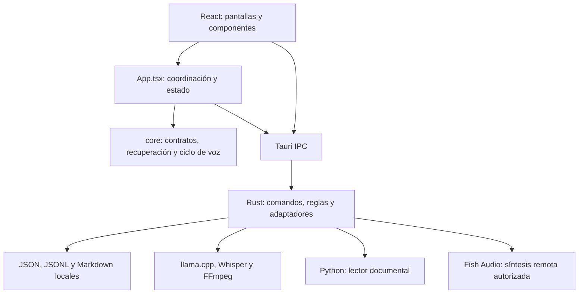

# Revisión de estructura y código · 5 de noviembre de 2026

Base inspeccionada: `aa6a749`. Esta es una revisión estructural con lectura focal
y comprobaciones de fallo, **no una auditoría manual completa de cada línea**.

## Alcance comprobable

- Inventario de **297 archivos** de `src/`, `src-tauri/src/` y `scripts/`:
  **70.997 líneas**, incluyendo estilos, herramientas, documentación auxiliar,
  pruebas separadas y pruebas embebidas en Rust.
- Lectura focal registrada en **23 archivos**. El inventario indica sus
  segmentos; los demás permanecen pendientes de revisión semántica.
- Búsqueda textual de imports e IPC: 357 relaciones locales de imports
  detectadas; sus destinos existen en Windows. Se contrastaron 134 llamadas
  literales `invoke` con 102 comandos registrados, sin nombres faltantes en ese
  conjunto. No es un parser semántico ni cubre exhaustivamente llamadas dinámicas,
  contratos de datos, diferencias de mayúsculas entre sistemas o todas las ramas.
- Dos sondas de fallo sobre las funciones originales en una **copia aislada del
  commit**, con datos ficticios. No se cambiaron fuentes de producción para
  ejecutarlas ni se usaron recuerdos personales.

[Inventario por archivo y estado de lectura](CODE_REVIEW_INVENTORY_2026-11-05.md).
Los resultados automáticos no convierten un archivo inventariado en uno revisado
en detalle. Tampoco el recuento de tests equivale a porcentaje de cobertura.

## Arquitectura que existe

La clasificación que corresponde al código es **monolito de escritorio
parcialmente modularizado**, organizado por capas técnicas y áreas funcionales,
con procesos auxiliares. No aplica todavía Clean Architecture estricta ni una
Vertical Slice completa.

El acceso directo de ciertos componentes a IPC está presente; el diagrama no
pretende una separación de capas más estricta que la implementada.

| Parte | Función y evidencia |
|---|---|
| `src/main.tsx`, `src/App.tsx` | Inicio React, navegación, estado y coordinación de servicios nativos. |
| `src/pages/`, `src/components/` | Interfaz agrupada por conversación, memoria, gobierno y cuerpo. |
| `src/core/` | Contratos y lógica frontend. `VoiceLoop` recibe puertos para captura, ASR, respuesta y salida. |
| `src-tauri/src/lib.rs` | Punto de composición Rust: gestores, hilos y registro de comandos. |
| `cloud.rs` | Validación, selección de ruta, conversación, herramientas delegadas, auditoría y registro de intercambios. |
| `memory.rs` y `memory/` | Fachada de comandos y separación de contratos, validación, consultas, casos y operaciones de archivos. |
| `local_inference.rs`, `whisper_input.rs`, `voice_output.rs`, `documents.rs` | Integración con motores y procesos, ASR, Fish y Python. |
| `permissions*`, `audit.rs`, `capabilities.rs` | Autorización, registro de evidencia e inventario de capacidades. |

Los procesos llama.cpp/Whisper/Python y sus llamadas locales no convierten por sí
solos la aplicación en microservicios. El producto se compone y distribuye como
una aplicación Tauri. Python es un adaptador; Rust coordina el backend y Gemma
aporta la generación de lenguaje.

Hay avances concretos de separación: los contratos de conversación ya viven fuera
de las pantallas; el ciclo de voz usa puertos; la memoria básica recibe rutas.
Sin embargo, `App.tsx` sigue coordinando muchas áreas, algunos componentes llaman
directamente a Tauri y varios módulos Rust reúnen contratos, comandos, casos,
adaptadores y tests. Separar carpetas no establece por sí solo una arquitectura
con dependencias dirigidas.

## Hallazgos

**Actualización posterior a esta revisión:** P1 y P2 se corrigieron mediante
[ADR-P-111](../decisions/ADR-P-111-persistencia-y-control-del-motor.md).
El [informe de fiabilidad](../testing/RELIABILITY_REPORT_2026-11-05.md) registra
las regresiones y sus límites. Las descripciones siguientes conservan la
reproducción sobre la base original; no describen el comportamiento corregido.

### P1 — Una operación básica puede devolver error después de cambiar la memoria

En [records.rs](../../Backend/src-tauri/src/memory/records.rs#L33), el guardado copia el
temporal sobre `records.json` y luego escribe la auditoría interna. La
[restauración](../../Backend/src-tauri/src/memory/records.rs#L119) también modifica la
fuente antes de auditar. Si falla esa auditoría, ambas funciones devuelven `Err`
y conservan el contenido nuevo en la fuente. Las fachadas
[save_memory](../../Backend/src-tauri/src/memory.rs#L543) y
[restore_memory_backup](../../Backend/src-tauri/src/memory.rs#L577) propagan el error.

**Reproducción:** crear una tienda ficticia válida y sustituir el archivo
`memory/audit/memory-events.jsonl` por un directorio. La inicialización de la
carpeta `audit/` sigue siendo posible, pero abrir ese destino como archivo falla.
Se ejecutaron `prepare_validated_save_at` + `save_prepared_at`, y
`prepare_restore_at` + `restore_prepared_at`. En ambos casos se comprobó:

1. La operación devuelve error.
2. La fuente ya contiene los bytes nuevos.
3. El respaldo conserva los bytes anteriores.

No se probó un corte físico del disco. Por lectura del código, el reemplazo básico
mediante `copy`/`write` tampoco es atómico, a diferencia de las primitivas que ya
utilizan varias operaciones avanzadas. Un error comunicado al cliente no permite
asumir que nada cambió; la vista podría quedar desincronizada con el disco.

**Prioridad propuesta:** definir y probar la semántica ante un fallo posterior a
la escritura; reutilizar las primitivas existentes de reemplazo, respaldo y
recuperación sin modificar el formato de recuerdos. Es un problema de lógica
transaccional, no una consecuencia de haber elegido Rust.

### P2 — Detener o consultar Gemma puede esperar una inferencia en curso

[gemma_chat](../../Backend/src-tauri/src/local_inference.rs#L67) conserva el bloqueo de
`child` durante el envío HTTP y la lectura de respuesta, con un timeout de
180 segundos. [stop](../../Backend/src-tauri/src/local_inference.rs#L380) y `snapshot`
necesitan ese mismo bloqueo. La señal `cancel` se usa durante el arranque, pero
no aborta esa petición HTTP.

Este hallazgo se confirma por la duración y orden de los bloqueos en el código;
no se forzó una inferencia de 180 segundos ni se interrumpió el modelo del
propietario. El resultado puede ser una parada o consulta de estado demorada.
La revocación de la sesión de voz y el descarte de respuestas tardías son otro
control y no equivalen a terminar la inferencia inmediatamente.

**Prioridad propuesta:** separar la exclusión de inferencia del control del
proceso y verificar cancelación con una operación pendiente, preservando la
propiedad del proceso y la regla de no cerrar motores ajenos.

### Organización — Las fronteras de módulos todavía se pueden mejorar

- `capabilities.rs` depende de memoria y conversación; memoria importa desde ese
  registro validadores de fechas y utilidades temporales. Hay dependencias en
  ambos sentidos: no constituyen por sí mismas un bucle de ejecución, pero
  contradicen una separación estricta entre reglas y adaptadores.
- `App.tsx` concentra coordinación de persistencia, conversación, visión, voz y
  gobierno. `MemoryAssociations.tsx` y `ConversationVision.tsx`, entre otros,
  también usan IPC directamente. La frontera de servicios es parcial.
- Los archivos grandes —por ejemplo, `tasks.rs`, `capabilities.rs` y
  `permissions.rs`— incluyen tests embebidos. Su tamaño identifica puntos para
  revisar, pero no demuestra por sí solo un defecto de diseño.
- Los contratos TypeScript y Rust son manuales. El contraste de nombres IPC no
  demuestra que todos sus campos y errores coincidan.

## Recorrido R9 inspeccionado

1. `HandsFreeVoice` conecta captura y reproducción con `VoiceLoop`.
2. `VoiceCapture` administra tracks, RNNoise, MediaRecorder y fin de turno.
3. `App.tsx` invoca transcripción Rust y compone el envío desde Conversación.
4. Rust comprueba la sesión, usa Whisper o la ruta de respaldo y devuelve texto.
5. `cloud.rs` valida, enruta y devuelve una respuesta; el ciclo registra el
   intercambio y revalida la sesión antes de continuar.
6. La salida obtiene el texto autorizado del historial y lo entrega a Fish;
   React reproduce y vuelve a escuchar.

Este recorrido conserva controles de generación y sesión para resultados tardíos.
No acredita activación por nombre, interrupción mientras habla ni calidad acústica
real. El propietario tiene pendientes esas aceptaciones. Avatar y cuerpo siguen
fuera del alcance activo de R9.

## Continuación de la revisión

Resueltos los dos hallazgos focales, queda ampliar la revisión semántica de permisos,
tareas, habilidades y operaciones avanzadas de memoria según el inventario. La
prueba real de conversación continúa siendo necesaria para R9.

En esta pasada no se reestructuró la aplicación, no se cambiaron dependencias ni
se modificó el icono que ya estaba en edición. No se repitió la suite completa:
la base tiene sus verificaciones previas y aquí se añadieron sólo las dos sondas
de fallo en una copia aislada. Su corrección y validación posterior están
documentadas en el informe de fiabilidad enlazado arriba.

Evidencia local: `local/artifacts/architecture-review-2026-11-05/` contiene el
snapshot, el inventario detallado y `persistence-probes.log`. Las pruebas de
demostración están en el snapshot, no en las fuentes de producción.
