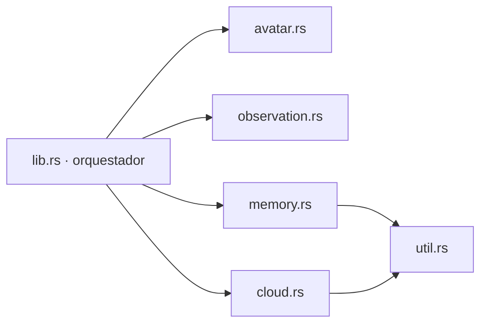

# Plan de modularización del backend Rust

Estado: aprobado para ejecución incremental  
Fecha: 2026-08-08

## Objetivo

Separar el backend nativo de Alice en módulos cohesivos sin cambiar los nombres de comandos Tauri, el contrato JSON consumido por React, las rutas de almacenamiento ni el comportamiento observable.

## Reglas de la migración

- Cero cambios funcionales durante la extracción.
- Identificar código por tipos y funciones, no por números de línea.
- Usar visibilidad `pub(crate)` solamente cuando el orquestador necesita acceder a un elemento.
- Mover los tests junto al módulo responsable y añadir cobertura donde hoy no existe.
- Ejecutar formato, pruebas y compilación después de cada etapa.
- No tocar la memoria de `data/`, el avatar privado de `Assets/` ni el proyecto histórico `E:\Alice`.

## Arquitectura de destino

| Módulo | Responsabilidad |
|---|---|
| `util.rs` | Tiempo y resolución de la raíz de datos de Alice |
| `avatar.rs` | Ruta, validación y estado del VRM local |
| `observation.rs` | Estado de observación, lectura Win32 y worker periódico |
| `memory.rs` | Tipos, validación, persistencia, respaldo, exportación y auditoría de memoria |
| `cloud.rs` | Proveedores, validación, adaptadores HTTP, parsers y auditoría de nube |
| `lib.rs` | Estado administrado, icono de ventana, registro de comandos e inicio de Tauri |



## Secuencia controlada

1. Registrar línea base de formato, pruebas, `clippy` y compilación.
2. Extraer `util` y `avatar`; verificar.
3. Extraer `observation` y añadir pruebas del estado; verificar.
4. Extraer `memory`, corregir tipos idiomáticos sin alterar resultados y mover sus tests; verificar.
5. Extraer `cloud` y mover sus tests; verificar.
6. Reducir `lib.rs` al orquestador y confirmar los nombres de comandos registrados.
7. Ejecutar auditoría completa de Rust y frontend.

## Contratos que no pueden cambiar

- Comandos: `execute_context_observation_grant`, `get_foreground_context`, comandos del Gateway R2, `load_memory`, `save_memory`, `export_memory`, `restore_memory_backup`, `open_memory_directory`, `avatar_status`, `cloud_status`, `send_cloud_message`.
- Serialización `camelCase` y campo de evento `type`.
- Variables de entorno y proveedores registrados.
- `ALICE_DATA_DIR`, estructura `memory/` y auditoría `cloud/cloud-audit.jsonl`.
- Icono aplicado a la ventana `main` y worker de observación iniciado una sola vez.

## Verificación por etapa

```powershell
cargo fmt --manifest-path src-tauri\Cargo.toml -- --check
cargo test --manifest-path src-tauri\Cargo.toml
cargo clippy --manifest-path src-tauri\Cargo.toml -- -D warnings
cargo build --manifest-path src-tauri\Cargo.toml
npm test
npm run build
```

## Criterios de aceptación

1. Todos los comandos conservan nombre y firma serializada.
2. Los tests anteriores y nuevos aprueban.
3. `clippy` termina sin advertencias.
4. `lib.rs` contiene únicamente declaración de módulos y orquestación.
5. La interfaz compila después de mover `Page` a `src/Page`.
6. No cambia ningún archivo dentro de `data/`, `Assets/` o `E:\Alice`.
